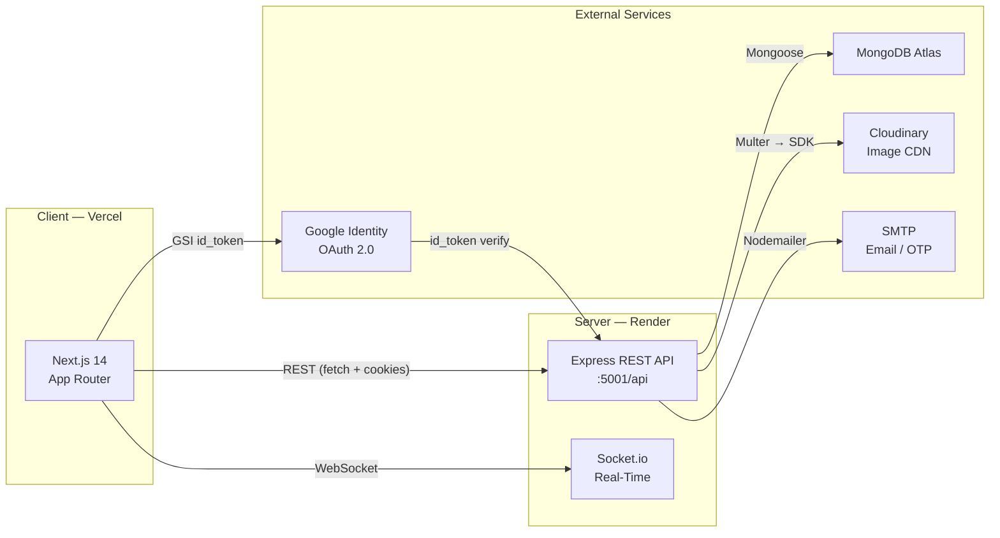
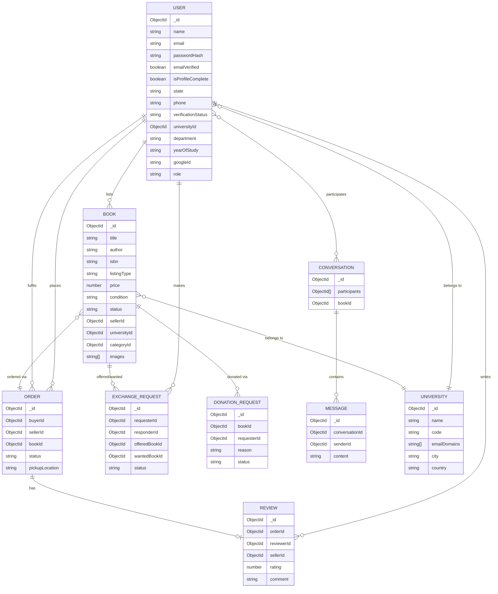

# 📚 CampusBook — Student Textbook Marketplace & Exchange Platform

[](https://nextjs.org/)
[](https://react.dev/)
[](https://www.typescriptlang.org/)
[](https://tailwindcss.com/)
[](https://nodejs.org/)
[](https://expressjs.com/)
[](https://www.mongodb.com/)
[](https://socket.io/)

> **CampusBook** is a full-stack, peer-to-peer textbook marketplace built exclusively for university students. Buy, sell, swap, and donate textbooks directly within your campus community — saving money, reducing waste, and connecting students across India.

🔗 **Live Demo**: [campus-book-dusky.vercel.app](https://campus-book-dusky.vercel.app)

---

## 📸 Screenshots

> Screenshots are located in `docs/screenshots/`. The app supports full **dark mode** and **light mode** with a consistent emerald/green campus design system across all pages.

| Dark Mode — Explore | Dark Mode — Colleges | Dark Mode — Events |
|---|---|---|
| *(docs/screenshots/explore-dark.png)* | *(docs/screenshots/colleges-dark.png)* | *(docs/screenshots/events-dark.png)* |

---

## 🌟 Features by Area

### 🔐 Authentication & Identity

CampusBook uses a **two-tier access model** to keep the community trustworthy.

#### Signup & Email Verification
- **Register** with name, email (personal or college), and password — no login without registering first.
- A **6-digit OTP** is sent immediately to the registered email.
  - Stored as a **bcrypt hash** (never plaintext).
  - Expires in **10 minutes**.
  - Max **5 attempts** before the OTP is invalidated.
  - **60-second resend cooldown**.
  - Rate-limited endpoint.
- Login with an email that does not exist prompts registration. Login with an unverified email resends the OTP and redirects to the verification page.

#### Complete Your Profile (required after OTP)
After OTP verification the user is taken to `/complete-profile`:
- **State** (required — Indian state dropdown)
- **Phone number** (required — validated Indian 10-digit mobile, stored but no SMS OTP)
- University, course/branch, year of study (optional searchable pickers)

Users with an incomplete profile are redirected to `/complete-profile` after every login.

#### Google Sign-In
- Google OAuth counts as `emailVerified: true` — no email OTP step.
- The user still completes the profile step (state + phone) before exploring.
- Requires college verification for full/seller access.

#### Two-Tier Access
| Tier | Requirement | Permitted Actions |
|---|---|---|
| **Browse** | `emailVerified: true` | Explore books, view seller profiles, wishlist, notifications, edit profile |
| **Full / Seller** | `verificationStatus: "verified"` | Sell, cart checkout, exchange requests, donation requests, start chats |

#### Student Verification (`/verify`)
Two methods, clearly explained in the modal:
1. **College Email OTP** — email domain must match the selected university's allowed domains (gmail/yahoo/outlook rejected); on success sets `verificationStatus: "verified"` instantly.
2. **College ID Card Upload** — image uploaded to Cloudinary; pending admin approval (also supports passout students uploading their old ID). Earns the **"Verified Student"** badge.

---

### 🛒 Marketplace & Book Discovery
- **Multi-Type Listings**: Buy/Sell, Exchange, or Free Donation — each with its own navbar entry and filter.
- **Advanced Search & Filtering**: 400ms debounced real-time search on title, author, ISBN, course code. Filters: university, category, condition, price range, listing type, semester.
- **Dynamic Sorting & Pagination**: Newest, price low-high, price high-low, popularity. All filter state is bookmarkable via URL query params.
- **Detailed Book Pages**: Image gallery, condition ratings (`New`, `Like New`, `Good`, `Fair`, `Poor`), university course info, price savings, and similar book recommendations.

### 🛍️ Cart, Wishlist & Orders
- **Persistent Cart & Wishlist**: Badge counts update instantly with optimistic UI.
- **Direct & Cart Checkout**: `Buy Now` modal or full cart checkout with campus pickup location.
- **Order Lifecycle**: `placed` → `confirmed` → `completed` or `cancelled` with automated book status tracking.

### 🔄 Book Exchanges & Smart Matching
- Automated algorithm pairs students who want to swap textbooks for upcoming semester courses.
- Send, accept, or decline 1-to-1 book swap requests with custom proposals.

### 🎁 Free Textbook Donations
- Dedicated donation channel for seniors/graduates to give books to incoming peers.
- Need-based donation requests with reason statement and donor approval workflow.

### 💬 Real-Time Campus Chat (Socket.io)
- Instant peer-to-peer messaging between buyers, sellers, and exchange partners.
- Typing indicators, online status, unread message badges, and links to active listings.

### ⭐ Trust, Reviews & Ratings
- 1–5 star peer reviews left by buyers on order completion; dynamically updates seller reputation.

### 🛡️ Admin Portal
- Platform analytics: revenue, active users, top universities, conversion metrics (Recharts).
- Listing moderation: approve/reject pending book submissions.
- Entity management: full CRUD for universities, categories, users, orders, exchange requests, donation claims.
- User moderation: suspend/reactivate users, review reports, resolve disputes.
- Student ID card review queue with approve/reject and reason modal.

---

## 🏗️ Architecture

```
CampusBook/
├── client/                       # Next.js 14 App Router Frontend
│   ├── public/                   # Static assets & illustrations
│   └── src/
│       ├── app/                  # App Router pages & layouts
│       │   ├── login/            # Login page (email+password, Google)
│       │   ├── signup/           # Register page (name, email, password)
│       │   ├── verify-otp/       # 6-digit OTP entry with 60s resend cooldown
│       │   ├── complete-profile/ # State + phone + optional university/course
│       │   ├── verify/           # Student verification (college email OTP or ID upload)
│       │   ├── forgot-password/  # Password reset request
│       │   ├── reset-password/   # Password reset with token
│       │   ├── explore/          # Marketplace search & filter catalog
│       │   ├── books/[id]/       # Book detail + order modal
│       │   ├── sell/             # 5-step book listing wizard
│       │   ├── my-books/         # Seller listing inventory
│       │   ├── cart/             # Shopping cart & checkout
│       │   ├── orders/           # Order tracker (buying & selling)
│       │   ├── exchanges/        # Exchange requests & proposals
│       │   ├── exchange-matches/ # Smart match feed
│       │   ├── donations/        # Donation catalog & requests
│       │   ├── messages/         # Socket.io chat rooms
│       │   ├── wishlist/         # Saved books
│       │   ├── notifications/    # Notification centre
│       │   ├── dashboard/        # Student overview
│       │   ├── profile/          # Public & own user profile
│       │   ├── settings/         # Account, email, password settings
│       │   ├── colleges/         # Partner college directory
│       │   ├── events/           # Campus book fairs & drives
│       │   └── admin/            # Admin portal (dashboard, books, users, orders…)
│       ├── components/           # Navbar, Footer, ProtectedRoute, RejectReasonModal…
│       ├── context/              # AuthContext, CartContext, SocketContext
│       ├── hooks/                # Custom React hooks (debounce, toast, media query…)
│       ├── lib/                  # API client, Zod validation schemas, utilities
│       └── types/                # Shared TypeScript interfaces
│
├── server/                       # Node.js + Express Backend
│   └── src/
│       ├── config/               # Mongoose, Cloudinary, Socket.io setup
│       ├── controllers/          # MVC controllers (auth, books, orders, chat…)
│       ├── docs/                 # Swagger / OpenAPI specification
│       ├── middlewares/          # JWT auth, rate limiting, Multer upload, error handler
│       ├── models/               # Mongoose schemas (see ER diagram below)
│       ├── routes/               # Express API routes
│       ├── scripts/              # Database migration scripts
│       ├── seeds/                # Seed data (universities, categories, users, books)
│       ├── services/             # Socket.io events, email, smart match algorithm
│       ├── utils/                # Nodemailer transporter, JWT helpers, AppError
│       ├── validations/          # Zod request schemas
│       ├── app.js                # Express application configuration
│       └── server.js             # HTTP + Socket.io entry point
│
└── README.md
```

---

## 🏛️ System Architecture Diagram



---

## 🗺️ User Journey

```mermaid
flowchart TD
    A([Visit CampusBook]) --> B{Have account?}
    B -- No --> C[Register: name + email + password]
    C --> D[Email OTP sent]
    D --> E{OTP correct?}
    E -- No / Expired --> D
    E -- Yes --> F[Complete Profile\nstate + phone]
    F --> G([/explore — Browse Access])
    B -- Yes, unverified --> D
    B -- Yes, verified --> G
    A --> GOOGLE[Google Sign-In]
    GOOGLE --> F

    G --> H{Want to sell / exchange\nor start a chat?}
    H -- Yes --> V[/verify — Student Verification]
    V --> V1[College Email OTP\nmatches university domain]
    V --> V2[College ID Card Upload\nadmin approval]
    V1 --> FULL([Full Access\n✅ Verified Student])
    V2 --> FULL

    G --> BROWSE[Browse books\nWishlist\nEdit profile\nNotifications]
    FULL --> SELL[List book for sale\nCart checkout\nExchange request\nDonation request\nStart chat]
```

---

## 🗄️ Entity Relationship Diagram



---

## 💻 Tech Stack

### Frontend

| Technology | Purpose |
|---|---|
| [Next.js 14](https://nextjs.org/) (App Router) | Framework — SSR, routing, layouts, Server Components |
| [TypeScript](https://www.typescriptlang.org/) | Type-safe client code |
| [Tailwind CSS](https://tailwindcss.com/) | Utility-first styling with custom campus emerald theme & `dark:` variants |
| [React Hook Form](https://react-hook-form.com/) + [Zod](https://zod.dev/) | Form state management + validation resolvers |
| [Socket.io Client](https://socket.io/docs/v4/client-api/) | Real-time messaging |
| [Lucide React](https://lucide.dev/) | Icon library |
| [Recharts](https://recharts.org/) | Admin analytics charts |
| [Framer Motion](https://www.framer.com/motion/) | UI animations |

### Backend

| Technology | Purpose |
|---|---|
| [Node.js 18+](https://nodejs.org/) (ES Modules) | Runtime |
| [Express.js](https://expressjs.com/) | REST API framework |
| [MongoDB Atlas](https://www.mongodb.com/) + [Mongoose 8](https://mongoosejs.com/) | Database & ODM |
| [Socket.io](https://socket.io/) | WebSocket real-time layer |
| [Cloudinary](https://cloudinary.com/) + [Multer](https://github.com/expressjs/multer) | Image storage & upload middleware |
| [Nodemailer](https://nodemailer.com/) | SMTP email (OTP delivery, notifications) |
| [bcryptjs](https://github.com/dcodeIO/bcrypt.js) | Password & OTP hashing |
| [Google Auth Library](https://github.com/googleapis/google-auth-library-nodejs) | Google ID token verification |
| [Helmet](https://helmetjs.github.io/), HPP, express-mongo-sanitize | HTTP security headers & sanitization |
| [express-rate-limit](https://github.com/express-rate-limit/express-rate-limit) | Brute-force protection |
| [Swagger UI](https://swagger.io/tools/swagger-ui/) | Interactive API docs at `/api/docs` |
| [Jest](https://jestjs.io/) + [Supertest](https://github.com/ladjs/supertest) + [mongodb-memory-server](https://github.com/nodkz/mongodb-memory-server) | Automated API testing |

---

## 🚀 Local Setup

### Prerequisites
- **Node.js** v18.0.0+
- **npm** v9.0.0+
- A **MongoDB** connection (local `mongodb://127.0.0.1:27017` or MongoDB Atlas URI)

### 1 · Clone

```bash
git clone https://github.com/your-username/CampusBook.git
cd CampusBook
```

### 2 · Configure Environment Variables

#### Backend — `server/.env`

```env
# Server
PORT=5001
NODE_ENV=development
CLIENT_URL=http://localhost:3000
ENABLE_DOCS=true

# MongoDB Atlas (or local)
MONGO_URI=mongodb://127.0.0.1:27017/campusbook

# JWT — generate a random secret of at least 32 characters
JWT_SECRET=replace_with_a_random_32_char_secret
JWT_EXPIRES_IN=7d

# Google OAuth (required for Google Sign-In)
GOOGLE_CLIENT_ID=your_google_client_id.apps.googleusercontent.com

# Cloudinary (optional locally — placeholders used if blank)
CLOUDINARY_CLOUD_NAME=your_cloud_name
CLOUDINARY_API_KEY=your_api_key
CLOUDINARY_API_SECRET=your_api_secret

# SMTP — required for OTP email delivery
# Use Mailtrap, Gmail, Resend, etc.
EMAIL_HOST=smtp.mailtrap.io
EMAIL_PORT=2525
EMAIL_USER=your_smtp_user
EMAIL_PASS=your_smtp_password
EMAIL_FROM="CampusBook <no-reply@campusbook.example>"
```

#### Frontend — `client/.env.local`

```env
# Backend REST API
NEXT_PUBLIC_API_URL=http://localhost:5001/api

# Backend Socket.io
NEXT_PUBLIC_SOCKET_URL=http://localhost:5001

# Google Identity Services (same client ID as above)
NEXT_PUBLIC_GOOGLE_CLIENT_ID=your_google_client_id.apps.googleusercontent.com
```

> [!CAUTION]
> Never commit real credentials. The `.env` and `.env.local` files are already in `.gitignore`. Only commit `*.env.example` templates with empty values.

### 3 · Install Dependencies

```bash
# Backend
cd server
npm install

# Frontend
cd ../client
npm install
```

### 4 · Seed the Database

```bash
cd ../server
npm run seed
```

This populates universities, academic categories, sample student accounts, and textbook listings.

### 5 · Run (Two Terminals)

```bash
# Terminal 1 — Express + Socket.io on :5001
cd server && npm run dev

# Terminal 2 — Next.js on :3000
cd client && npm run dev
```

Open [http://localhost:3000](http://localhost:3000).

---

## 🗃️ Database Migration

If you have an existing database from before the email-verification update, run this once to avoid locking out existing users:

```bash
cd server
npm run migrate:emailverified
```

**What it does:**
- Sets `emailVerified: true` for all users who already have `verificationStatus: "verified"` or signed in with Google.
- Sets `isProfileComplete: true` for users who already have a phone number or were previously verified — so no existing user is forced through the new profile-completion step.

---

## 📡 API Reference

| Module | Method | Endpoint | Description | Access |
|---|---|---|---|---|
| **Auth** | `POST` | `/api/auth/register` | Register (name + email + password). Returns OTP-required flag. | Public |
| **Auth** | `POST` | `/api/auth/verify-otp` | Submit 6-digit OTP; sets `emailVerified: true`, issues JWT cookie | Public |
| **Auth** | `POST` | `/api/auth/resend-otp` | Resend OTP (60 s cooldown, rate-limited) | Public |
| **Auth** | `POST` | `/api/auth/complete-profile` | Save state + phone (+ optional fields) | Private |
| **Auth** | `POST` | `/api/auth/login` | Email + password login (403 if unverified) | Public |
| **Auth** | `POST` | `/api/auth/google` | Google ID-token exchange; sets JWT cookie | Public |
| **Auth** | `GET` | `/api/auth/me` | Fetch current session | Private |
| **Auth** | `POST` | `/api/auth/logout` | Clear auth cookie | Private |
| **Auth** | `POST` | `/api/auth/forgot-password` | Request password reset link | Public |
| **Auth** | `POST` | `/api/auth/reset-password` | Reset with token | Public |
| **Books** | `GET` | `/api/books` | Search, filter, paginate marketplace books | Public |
| **Books** | `GET` | `/api/books/filters-meta` | Aggregated facet counts | Public |
| **Books** | `GET` | `/api/books/:id` | Single book detail + views + rating | Public |
| **Books** | `GET` | `/api/books/:id/similar` | Up to 6 similar recommendations | Public |
| **Books** | `POST` | `/api/books` | Create listing (multipart, up to 5 images) | Verified |
| **Books** | `GET` | `/api/books/my` | Seller's own listings | Private |
| **Books** | `PATCH` | `/api/books/:id/mark-sold` | Mark as sold | Private (Owner) |
| **Wishlist** | `GET/POST/DELETE` | `/api/wishlist/:bookId` | Add / remove / list saved books | Private |
| **Cart** | `GET/POST/DELETE` | `/api/cart/:bookId` | Add / remove / list / clear cart | Private |
| **Orders** | `POST` | `/api/orders` | Place order (single book or full cart) | Verified |
| **Orders** | `GET` | `/api/orders?role=buying\|selling` | List orders | Private |
| **Orders** | `PATCH` | `/api/orders/:id/status` | Confirm / cancel / complete | Private |
| **Reviews** | `POST` | `/api/reviews` | Submit rating for completed order | Private (Buyer) |
| **Reviews** | `GET` | `/api/users/:id/reviews` | Public reviews for a seller | Public |
| **Exchanges** | `POST` | `/api/exchanges` | Create exchange request | Verified |
| **Exchanges** | `GET` | `/api/exchanges/matches` | Smart match feed | Private |
| **Donations** | `POST` | `/api/donations` | Request a donated book | Verified |
| **Verification** | `POST` | `/api/verification/college-email` | Send college-email OTP | Private |
| **Verification** | `POST` | `/api/verification/college-email/verify` | Verify college-email OTP | Private |
| **Verification** | `POST` | `/api/verification/id-card` | Upload college ID card image | Private |
| **Chat** | `GET` | `/api/conversations` | List conversations | Private |
| **Chat** | `GET` | `/api/conversations/:id/messages` | Fetch messages | Private |
| **Admin** | `GET` | `/api/admin/analytics/overview` | Platform KPIs | Admin |
| **Admin** | `PATCH` | `/api/admin/books/:id/status` | Approve / reject listing | Admin |

> Interactive Swagger docs: `http://localhost:5001/api/docs` (requires `ENABLE_DOCS=true`)

---

## 🔒 Security Practices

| Measure | Detail |
|---|---|
| HTTP-Only cookies | JWT stored in `httpOnly SameSite=Lax` cookie — XSS-proof |
| OTP bcrypt hashing | OTPs are hashed with bcrypt before storage; never stored as plaintext |
| OTP brute-force limit | Max 5 wrong attempts per OTP before invalidation |
| Resend cooldown | 60-second minimum between OTP resends |
| Rate limiting | Auth and OTP endpoints are rate-limited via `express-rate-limit` |
| Login gate | 403 `EMAIL_NOT_VERIFIED` returned for unverified emails — no session issued |
| Sell/exchange gate | `requireVerified` middleware returns 403 `VERIFICATION_REQUIRED` for non-verified users |
| NoSQL injection | `express-mongo-sanitize` strips `$` and `.` from request inputs |
| HTTP parameter pollution | `hpp` deduplicates query parameters |
| Helmet | Full suite of secure HTTP response headers |
| File upload validation | MIME type (JPEG/PNG/WEBP) + 5 MB size enforced by Multer before Cloudinary upload |
| College email domain check | Only domains matching the university's `emailDomains` list are accepted; gmail/yahoo/outlook blocked |

---

## 🧪 Testing

### Backend (Jest + Supertest + mongodb-memory-server)

```bash
cd server
npm test                # run all tests
npm run test:coverage   # with coverage report
```

**Test coverage includes:**
- Register → OTP sent (`requiresVerification: true`)
- Wrong OTP → rejected
- Expired OTP → rejected
- Attempt limit (5) → locked
- Unverified email login → 403 `EMAIL_NOT_VERIFIED`
- Profile step required → redirect guard
- Browse allowed for email-verified user
- Sell blocked with 403 until `verificationStatus: "verified"`
- College email domain check (valid domain accepted, gmail rejected)

### TypeScript Type-Checking (Client)

```bash
cd client
npx tsc --noEmit   # must return 0 errors
```

---

## ☁️ Deployment Guide

### MongoDB Atlas
1. Create a free M0 cluster at [cloud.mongodb.com](https://cloud.mongodb.com).
2. Add your Render server IP (or `0.0.0.0/0` during dev) to the **IP Access List**.
3. Create a database user and copy the connection string.
4. Set `MONGO_URI` in Render environment variables.

### Backend → Render
1. Create a new **Web Service** pointing to the `server/` directory.
2. Set **Build Command**: `npm install`
3. Set **Start Command**: `node src/server.js`
4. Add all variables from `server/.env.example` in the Render **Environment** tab.
5. Set `NODE_ENV=production`, `CLIENT_URL=https://your-vercel-app.vercel.app`.

### Frontend → Vercel
1. Import the repo into [vercel.com](https://vercel.com).
2. Set **Root Directory** to `client`.
3. Add `NEXT_PUBLIC_API_URL` and `NEXT_PUBLIC_SOCKET_URL` pointing to your Render service URL.
4. Add `NEXT_PUBLIC_GOOGLE_CLIENT_ID`.
5. Deploy — Vercel auto-builds on every push to `main`.

### After First Deploy — Run Migration
```bash
# From your local machine with MONGO_URI set
cd server
npm run migrate:emailverified
```

---

## 🧩 Challenges & Learnings

- **`useSearchParams` in Next.js App Router**: `usePathname()` does not include query strings, so `pathname.includes('listingType=exchange')` always evaluates to `false`. Navbar active-link highlighting for filter-based routes (Exchange, Free Donations) requires `useSearchParams()`, which in turn needs a `<Suspense>` wrapper.
- **OTP security without SMS cost**: bcrypt-hashing the OTP before storing it means even a database leak exposes nothing useful, while keeping the system free of any SMS provider dependency.
- **Tiered access UX**: Separating "email verified = can browse" from "college verified = can sell" required coordinating multiple middleware layers (`requireAuth`, `requireProfileComplete`, `requireVerified`) without breaking the Google OAuth flow, which skips the email-OTP step.
- **Dark/Light mode consistency**: Tailwind's `dark:` variant must be applied to every element individually; global wrapper classes alone are insufficient for deeply nested components.
- **Socket.io in a serverless environment**: Socket.io requires a persistent Node.js process, so the backend is kept on Render (always-on) while the Next.js front-end is on Vercel (serverless). The two communicate over HTTP for REST and WebSocket for real-time events.

---

## 🔮 Future Improvements

- Push notifications (PWA + Web Push API)
- In-app payment gateway integration for book purchases
- AI-powered book recommendations based on user course history
- WhatsApp bot for quick listing lookup
- Campus ambassador leaderboard and referral rewards
- Multi-language support (Hindi, regional languages)
- Mobile app (React Native / Expo)

---

## 👤 Author

**CampusBook** was designed and built as a full-stack capstone project demonstrating real-world product engineering practices — from secure multi-step authentication to real-time WebSocket chat and cloud-native image storage.

> Built with ❤️ for the student community of India.

---

## 🤝 Contributing

Contributions, issues, and feature requests are welcome!

1. Fork the project.
2. Create your feature branch: `git checkout -b feature/my-feature`
3. Commit your changes: `git commit -m 'feat: add my feature'`
4. Push to the branch: `git push origin feature/my-feature`
5. Open a Pull Request.

---

## 📄 License

This project is licensed under the [MIT License](LICENSE). Distributed freely for academic and university community use.
